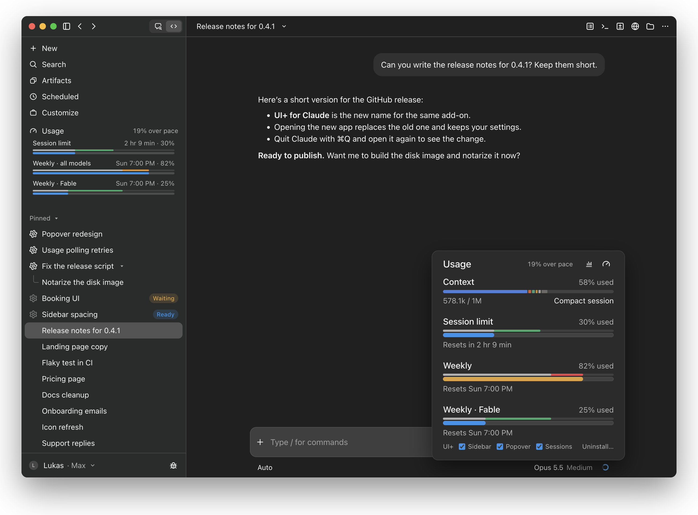
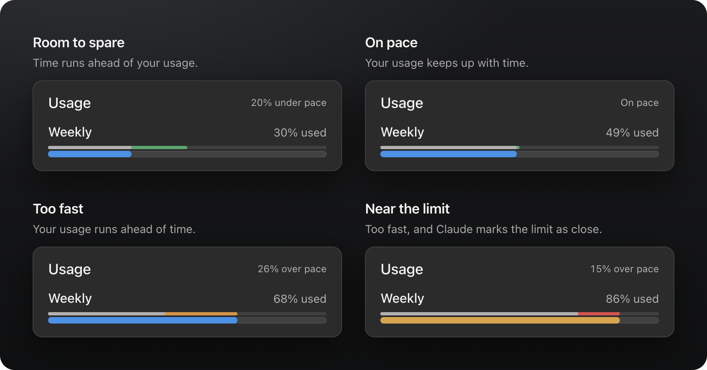
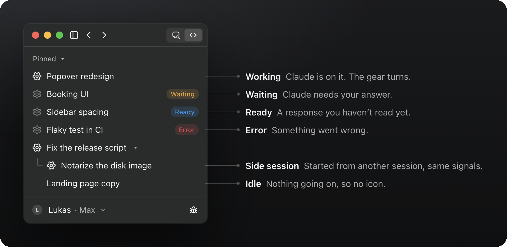
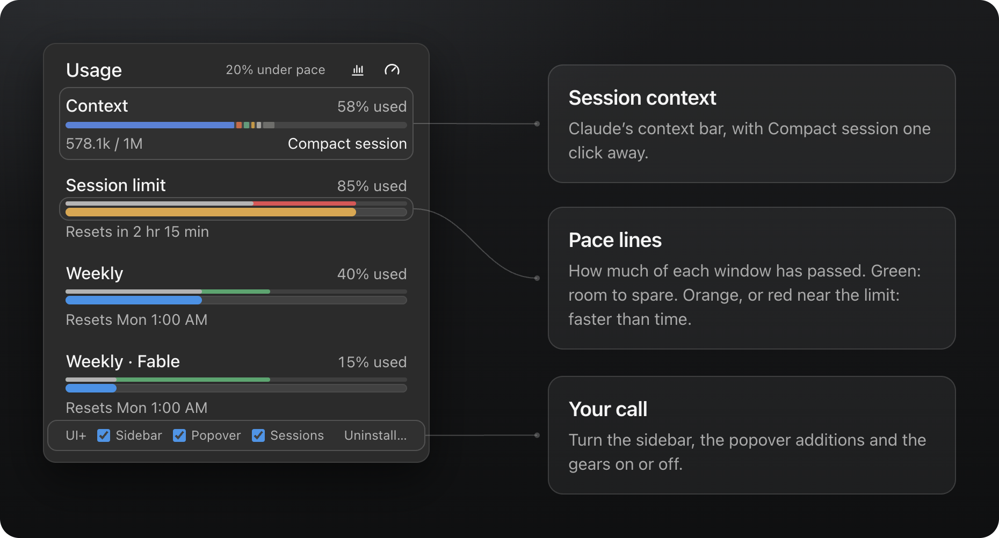

# UI+ for Claude

**See your Claude limits coming, and which sessions need you.** UI+ adds your plan usage with pace, the state of every session and the session's context to the Claude desktop app on your Mac.

[](https://github.com/LukasvanUden/ui-plus-for-claude/releases/latest/download/UI-Plus-for-Claude.dmg)

[](https://github.com/LukasvanUden/ui-plus-for-claude/releases/latest)
[](#private-by-design)
[](LICENSE)



Claude shows how much of your limits you've used, but not whether that's too fast for the time that's left, and not which of your sessions is busy or waiting for you. UI+ adds both, right where you work: in the sidebar and in Claude's usage popover. It uses Claude's own look, so it feels like part of the app.

**[Your limits, with pace](#your-limits-with-pace)** · **[Sessions at a glance](#sessions-at-a-glance)** · **[The usage popover](#the-usage-popover)** · **[Install](#install)**

## Your limits, with pace

The **Usage** row in the sidebar shows your session limit and your weekly limits as bars, always in view. Next to **Usage** you see how far over or under pace you are for the week, and above each bar a thin line shows how much of that window has passed:



| The line | means |
| --- | --- |
| **Grey** | Usage and time agree. |
| **Green** | Time is ahead of your usage: room to spare. |
| **Orange** | Your usage is ahead of time: you're going too fast. |
| **Red** | Too fast, and Claude already marks the limit as close. |

**On pace** means within three points of the time that has passed. Click **Usage** to fold the bars away.

## Sessions at a glance

Each session in the sidebar shows what Claude is doing in it, so you can work in one while the others run:



| State | Shows | Means |
| --- | --- | --- |
| **Working** | a turning gear | Claude is working on it. |
| **Waiting** | a still gear and **Waiting** | Claude needs your answer. |
| **Ready** | a still gear and **Ready** | A response you haven't read yet. |
| **Error** | a still gear and **Error** | Something went wrong. |
| **Idle** | no icon | Nothing going on. |

Side sessions, the ones started from another session and shown under it, get the same signals.

## The usage popover

The ring below the message box opens Claude's usage popover. UI+ adds to it:



- **Pace** next to **Usage**, and the same lines above every limit.
- **The session's context** above the limits, in Claude's own bar colored by what fills it (messages, tools, skills, …), with **Compact session** once Claude offers it (from 50%). With the session rail hidden, it offers **Show session rail** instead.
- **A UI+ row** at the bottom: turn the sidebar row, the popover additions and the session gears on or off, or **Uninstall…**.

Everything follows Claude's light or dark mode and its language, English or German.

## Install

1. Download **[UI-Plus-for-Claude.dmg](https://github.com/LukasvanUden/ui-plus-for-claude/releases/latest/download/UI-Plus-for-Claude.dmg)** and open it.
2. Drag **UI+ for Claude** onto **Applications**.
3. Open it from your Applications folder and click **OK**.
4. Quit Claude (⌘Q) and open it again.

**Or let an agent do it:** copy this prompt into Claude Code (or any agent that can run commands on your Mac):

```text
Install UI+ for Claude (https://github.com/LukasvanUden/ui-plus-for-claude) on this Mac by running:

curl -fL -o /tmp/UI-Plus-for-Claude.dmg https://github.com/LukasvanUden/ui-plus-for-claude/releases/latest/download/UI-Plus-for-Claude.dmg
hdiutil attach -nobrowse -quiet /tmp/UI-Plus-for-Claude.dmg
ditto "/Volumes/UI+ for Claude/UI+ for Claude.app" "/Applications/UI+ for Claude.app"
hdiutil detach -quiet "/Volumes/UI+ for Claude"
"/Applications/UI+ for Claude.app/Contents/Resources/UI+ for Claude" install

Do not quit the Claude app yourself. When done, tell me to quit Claude with Cmd+Q and open it again.
```

**Coming from Usage Pace?** UI+ for Claude is its new name. Install it as above: it replaces Usage Pace, moves the old app to the Trash and keeps your settings.

### From a git clone

```sh
git clone https://github.com/LukasvanUden/ui-plus-for-claude.git
cd ui-plus-for-claude
bash Scripts/build-app.sh
```

Then move `build/UI+ for Claude.app` to Applications and open it.

## Private by design

- It runs only on claude.ai inside the Claude desktop app, and only adds to what's on screen.
- It reads your usage through Claude's own API, with the session Claude is already signed in with. It stores no tokens, and your usage never leaves your Mac.
- Its only request of its own is a daily update check: it asks GitHub for the version number of the latest release and sends nothing about you or your usage.
- It's open source (MIT), signed with a Developer ID and notarized by Apple.

## Updates and uninstalling

- **Updates:** once a day, UI+ checks GitHub for a newer release. When there is one, it opens a dialog with a download link (once per release). From a git clone, update with `bash Scripts/update.sh`.
- **Uninstall:** click **Uninstall…** in the usage popover and everything disappears right away. To remove the files as well, open the app and click **Uninstall**, or move it to the Trash (it then stops at your next login). Restart Claude afterwards.

## FAQ

**Is this made by Anthropic?**
No. It's a community project, not affiliated with or endorsed by Anthropic.

**Which plans does it work with?**
Any Claude plan that shows usage limits in Claude's usage popover.

**What happens when Claude updates?**
Claude could change its interface or drop the developer hook UI+ relies on. If an update breaks something, the daily update check tells you when a fix is out.

**Windows or Linux?**
macOS only for now.

## How it works

When the Claude desktop app starts with the environment variable `REACT_PROFILE=1`, it loads a local browser extension from `~/Library/Application Support/Claude/extensions/fmkadmapgofadopljbjfkapdkoienihi`. This hook is meant for React DevTools; UI+ for Claude puts its own small extension there instead.

The app ([App/](App/)) copies [Extension/](Extension/) to that folder and adds a login item (`~/Library/LaunchAgents/io.github.lukasvanuden.usagepace.plist`, named after the add-on's first name, Usage Pace). At login and once a day, it sets `REACT_PROFILE=1` for apps you open and checks for updates. The login item runs from inside the app, so it stops once the app is gone.

- macOS lists the login item as **UI+ for Claude** under System Settings → General → Login Items & Extensions. Turning it off there stops UI+ after your next login.
- `REACT_PROFILE=1` is set for every app you open, not only Claude. Other apps normally ignore it.
- If Claude opens at login before the variable is set, UI+ appears after the next Claude restart.

## Development

```sh
npm install
npm test
```

`Scripts/build-app.sh` builds `build/UI+ for Claude.app`, signed ad hoc. `Scripts/release.sh <notarytool profile>` builds `build/UI-Plus-for-Claude.dmg` for a release: signed with your Developer ID and notarized by Apple. It lets Finder arrange the disk image window, so macOS asks once to let your terminal control Finder.

The images above come from [docs/mockup](docs/mockup/index.html): the Claude desktop app as it looks today (Code tab, dark), with the extension running inside. `?view=` picks the whole window (`hero`), the pace states (`pace`), the session states (`sessions`) or the usage popover (`popover`). Underneath, [docs/demo](docs/demo/index.html) answers the usage API and draws the popover; on its own, it has a toolbar to switch between scenarios (under, on or over pace, near the limit, new windows), context levels, English and German, and dark and light. Serve the repository and open either:

```sh
python3 -m http.server 4173
```

Then go to http://localhost:4173/docs/mockup/?view=hero or http://localhost:4173/docs/demo/. `npm run screenshots` exports the views to [docs/screenshots](docs/screenshots), and the session states as a GIF of the turning gears when ffmpeg is installed.

Usage numbers in the demo must be ones Claude can reach: a full 5-hour session uses about 20–25% of the weekly limit, so weekly usage is never below a fifth of the session's, and a model's weekly limit never exceeds the one for all models. The demo logs an error for a scenario that breaks this.

The tests load the extension into a stand-in for Claude ([Tests/fake-claude](Tests/fake-claude/main.js)) that serves a fake claude.ai page and usage API.

---

The project is [MIT licensed](LICENSE). Claude is a trademark of Anthropic, PBC. UI+ for Claude is an independent project and is not affiliated with, endorsed by, or sponsored by Anthropic.
