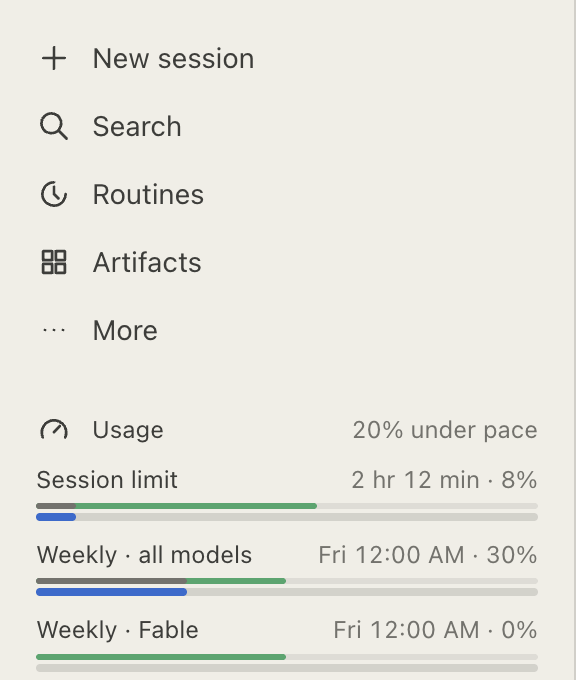
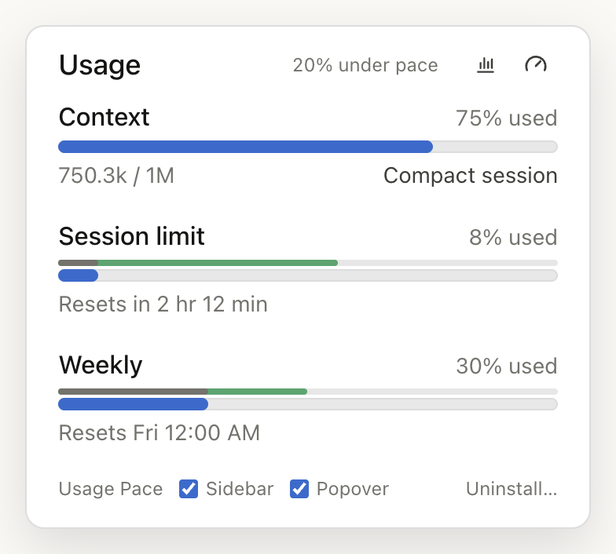
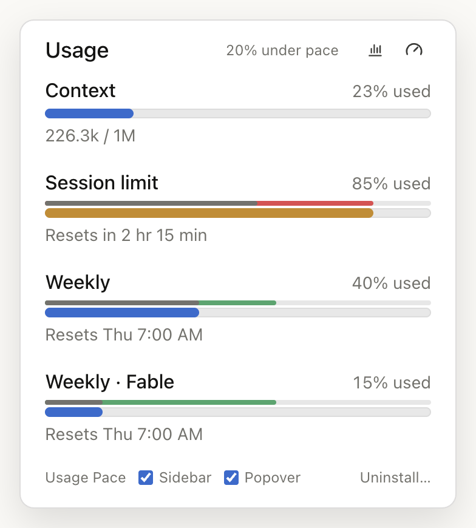
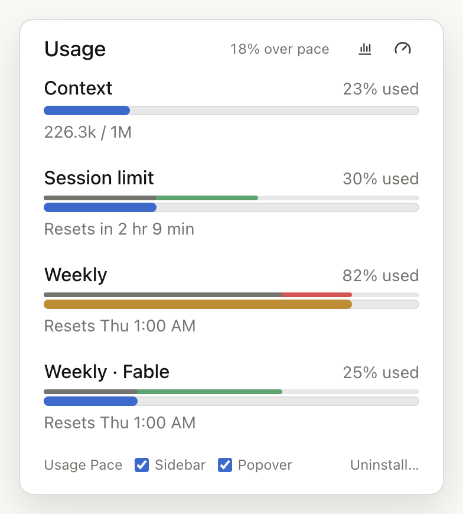
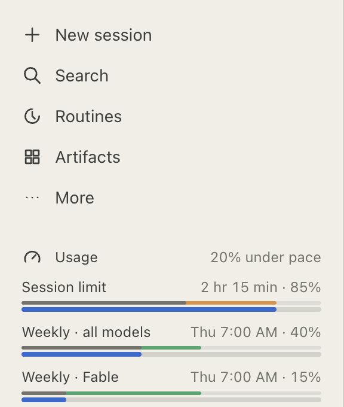
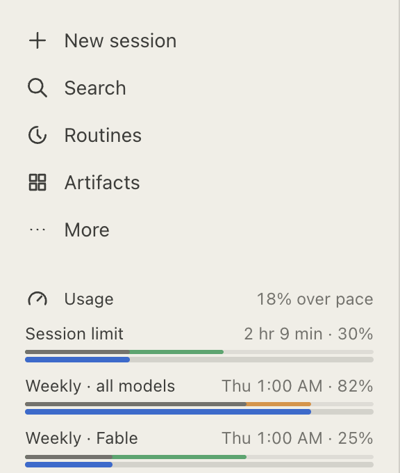

# Usage Pace for Claude

Your Claude plan usage, always visible in the sidebar of the Claude desktop app, with how far through each limit window you are.

A **Usage** row below **More** shows how far above or below pace your weekly usage is, e.g. "20% under pace". Click it to show or hide the bars:

<picture>
  <source media="(prefers-color-scheme: dark)" srcset="docs/screenshots/compact-sidebar-dark.png">
  
</picture>

- Bar: usage, exactly as in Claude's own usage view.
- Line above it: time elapsed in that window. Grey up to where usage and time agree, then green where time is ahead of usage (room to spare), or orange where usage is ahead of time (too fast). Once Claude colors a bar as near its limit, orange turns red.

Claude's usage popover (the ring below the message box) gets the same time lines and the weekly pace next to **Usage**. Above the limits, it shows the **context** of the current session again, with **Compact session** once Claude offers it (from 50%). Claude moved both into the Context card of the session rail, right of the conversation; the popover mirrors that card, so with the rail hidden it offers **Show session rail** instead. A **Usage Pace** row at the bottom turns the sidebar row and the popover additions on or off.

<picture>
  <source media="(prefers-color-scheme: dark)" srcset="docs/screenshots/compact-popover-dark.png">
  
</picture>

When one limit runs out faster than the other:

| Session limit tight, weekly fine | Weekly limit tight, session fine |
| --- | --- |
| <picture><source media="(prefers-color-scheme: dark)" srcset="docs/screenshots/session-tight-popover-dark.png"></picture> | <picture><source media="(prefers-color-scheme: dark)" srcset="docs/screenshots/weekly-tight-popover-dark.png"></picture> |
| <picture><source media="(prefers-color-scheme: dark)" srcset="docs/screenshots/session-tight-sidebar-dark.png"></picture> | <picture><source media="(prefers-color-scheme: dark)" srcset="docs/screenshots/weekly-tight-sidebar-dark.png"></picture> |

The text follows Claude's language (English or German).

## Install

1. Download **Usage-Pace.dmg** from the [latest release](https://github.com/LukasvanUden/usage-pace-for-claude/releases/latest) and open it.
2. Drag **Usage Pace** onto **Applications**.
3. Open **Usage Pace** from your Applications folder and click **OK**.
4. Quit Claude (Cmd+Q) and open it again.

### From a git clone

```sh
git clone https://github.com/LukasvanUden/usage-pace-for-claude.git
cd usage-pace-for-claude
bash Scripts/build-app.sh
```

Then move `build/Usage Pace.app` to Applications and open it.

## Updates

Once a day, Usage Pace checks GitHub for a newer release. When there is one, it opens a dialog with a download link (once per release). Download the new version, move it to Applications, and open it once.

From a git clone, update with:

```sh
bash Scripts/update.sh
```

It pulls, builds, replaces the app in Applications, and opens it once.

## Uninstall

- In Claude's usage popover, click **Uninstall…** next to Usage Pace. Everything disappears right away.
- To remove the files as well, open the **Usage Pace** app and click **Uninstall**, or move the app to the Trash (it then stops at your next login). Restart Claude afterwards.

## How it works

When the Claude desktop app starts with the environment variable `REACT_PROFILE=1`, it loads a local browser extension from `~/Library/Application Support/Claude/extensions/fmkadmapgofadopljbjfkapdkoienihi`. This hook is meant for React DevTools; Usage Pace for Claude puts its own small extension there instead.

The Usage Pace app ([App/](App/)) copies [Extension/](Extension/) to that folder and adds a login item (`~/Library/LaunchAgents/io.github.lukasvanuden.usagepace.plist`). At login and once a day, it sets `REACT_PROFILE=1` for apps you open and checks for updates. The login item runs from inside the app, so it stops once the app is gone.

The extension only runs on `https://claude.ai` inside Claude and reads your usage through claude.ai's own API, with the session Claude is already signed in with. It stores no tokens, and your usage never leaves your Mac. The only other network request is the daily update check: it asks the GitHub API for the version number of the latest release and sends nothing about you or your usage.

## Notes

- Usage Pace is a community project, not an Anthropic product. Claude could drop the developer hook it relies on in any update; the daily update check lets you know when a fix is out.
- macOS lists the login item as **Usage Pace** under System Settings → General → Login Items & Extensions. Turning it off there stops Usage Pace after your next login.
- `REACT_PROFILE=1` is set for every app you open, not only Claude. Other apps normally ignore it.
- If Claude opens at login before the variable is set, the bars appear after the next Claude restart.

## Development

```sh
npm install
npm test
```

`Scripts/build-app.sh` builds `build/Usage Pace.app`, signed ad hoc. `Scripts/release.sh <notarytool profile>` builds `build/Usage-Pace.dmg` for a release: signed with your Developer ID and notarized by Apple. It lets Finder arrange the disk image window, so macOS asks once to let your terminal control Finder.

For screenshots, [docs/demo](docs/demo/index.html) shows the extension on a stand-in for Claude's sidebar and usage popover, with a toolbar to switch between scenarios (under, on or over pace, near the limit, new windows), context levels, English and German, and dark and light. Serve the repository and open it:

```sh
python3 -m http.server 4173
```

Then go to http://localhost:4173/docs/demo/. `npm run screenshots` exports the popover and the sidebar for a few of these scenarios, in dark and light, to [docs/screenshots](docs/screenshots).

Usage numbers in the demo must be ones Claude can reach: a full 5-hour session uses about 20–25% of the weekly limit, so weekly usage is never below a fifth of the session's, and a model's weekly limit never exceeds the one for all models. The demo logs an error for a scenario that breaks this.

The tests load the extension into a stand-in for Claude ([Tests/fake-claude](Tests/fake-claude/main.js)) that serves a fake claude.ai page and usage API.

The project is [MIT licensed](LICENSE).
