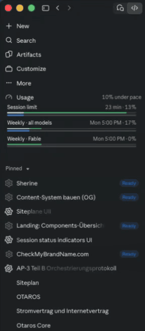

# UI+ for Claude

**See your Claude limits coming.** Plan usage with pace, active sessions and session context, right inside the Claude desktop app on your Mac.

[](https://github.com/LukasvanUden/ui-plus-for-claude/releases/latest/download/UI-Plus-for-Claude.dmg)

[](https://github.com/LukasvanUden/ui-plus-for-claude/releases/latest)
[](#private-by-design)
[](LICENSE)

<p>
  <picture>
    <source media="(prefers-color-scheme: dark)" srcset="docs/screenshots/compact-sidebar-dark.png">
    
  </picture>
  <picture>
    <source media="(prefers-color-scheme: dark)" srcset="docs/screenshots/compact-popover-dark.png">
    
  </picture>
</p>

Claude's limits reset every five hours and every week. Claude shows how much of them you've used, but not whether you're using them too fast, so the limit tends to arrive by surprise. UI+ for Claude shows you both, and adds a few things the Claude app is missing.

## What you get

- **Usage in the sidebar.** Your session and weekly limits as bars, always in view, with how far over or under pace you are for the week, e.g. "13% over pace". Click the **Usage** row to show or hide the bars.
- **Pace at a glance.** A thin line above each bar shows how much of that window has passed. Green: room to spare. Orange: you're using it faster than time passes. Red: the same, close to the limit.
- **Sessions that stand out.** A turning gear marks every session Claude is working on. When a session needs you, it stops and shows **Waiting**, **Ready** or **Error**. Sessions with nothing going on show no icon.
- **Context in the usage popover.** The ring below the message box gets the same time lines, plus the current session's context in Claude's own colored bar, with **Compact session** one click away.
- **Feels native.** It uses Claude's own styles, follows light and dark mode, and speaks English and German, like Claude.



When one limit runs out faster than the other:

| Session limit tight, weekly fine | Weekly limit tight, session fine |
| --- | --- |
| <picture><source media="(prefers-color-scheme: dark)" srcset="docs/screenshots/session-tight-popover-dark.png"></picture> | <picture><source media="(prefers-color-scheme: dark)" srcset="docs/screenshots/weekly-tight-popover-dark.png"></picture> |
| <picture><source media="(prefers-color-scheme: dark)" srcset="docs/screenshots/session-tight-sidebar-dark.png"></picture> | <picture><source media="(prefers-color-scheme: dark)" srcset="docs/screenshots/weekly-tight-sidebar-dark.png"></picture> |

## Install

1. Download **[UI-Plus-for-Claude.dmg](https://github.com/LukasvanUden/ui-plus-for-claude/releases/latest/download/UI-Plus-for-Claude.dmg)** and open it.
2. Drag **UI+ for Claude** onto **Applications**.
3. Open it from your Applications folder and click **OK**.
4. Quit Claude (⌘Q) and open it again.

**Or let an agent do it:** copy this prompt into Claude Code (or any agent that can run commands on your Mac):

```text
Install UI+ for Claude (https://github.com/LukasvanUden/ui-plus-for-claude) on this Mac by running:

curl -fL -o /tmp/UI-Plus-for-Claude.dmg https://github.com/LukasvanUden/ui-plus-for-claude/releases/latest/download/UI-Plus-for-Claude.dmg
hdiutil attach -nobrowse -quiet /tmp/UI-Plus-for-Claude.dmg
ditto "/Volumes/UI+ for Claude/UI+ for Claude.app" "/Applications/UI+ for Claude.app"
hdiutil detach -quiet "/Volumes/UI+ for Claude"
"/Applications/UI+ for Claude.app/Contents/Resources/UI+ for Claude" install

Do not quit the Claude app yourself. When done, tell me to quit Claude with Cmd+Q and open it again.
```

**Coming from Usage Pace?** UI+ for Claude is its new name. Install it as above: it replaces Usage Pace, moves the old app to the Trash and keeps your settings.

### From a git clone

```sh
git clone https://github.com/LukasvanUden/ui-plus-for-claude.git
cd ui-plus-for-claude
bash Scripts/build-app.sh
```

Then move `build/UI+ for Claude.app` to Applications and open it.

## Private by design

- It runs only on claude.ai inside the Claude desktop app, and only adds to what's on screen.
- It reads your usage through Claude's own API, with the session Claude is already signed in with. It stores no tokens, and your usage never leaves your Mac.
- Its only request of its own is a daily update check: it asks GitHub for the version number of the latest release and sends nothing about you or your usage.
- It's open source (MIT), signed with a Developer ID and notarized by Apple.

## Settings, updates and uninstalling

- **Settings:** the **UI+** row at the bottom of Claude's usage popover turns the sidebar row, the popover additions and the session gears on or off.
- **Updates:** once a day, the add-on checks GitHub for a newer release. When there is one, it opens a dialog with a download link (once per release). From a git clone, update with `bash Scripts/update.sh`.
- **Uninstall:** click **Uninstall…** in the usage popover and everything disappears right away. To remove the files as well, open the app and click **Uninstall**, or move it to the Trash (it then stops at your next login). Restart Claude afterwards.

## FAQ

**Is this made by Anthropic?**
No. It's a community project, not affiliated with or endorsed by Anthropic.

**Which plans does it work with?**
Any Claude plan that shows usage limits in Claude's usage popover.

**What happens when Claude updates?**
Claude could change its interface or drop the developer hook the add-on relies on. If an update breaks something, the daily update check tells you when a fix is out.

**Windows or Linux?**
macOS only for now.

## How it works

When the Claude desktop app starts with the environment variable `REACT_PROFILE=1`, it loads a local browser extension from `~/Library/Application Support/Claude/extensions/fmkadmapgofadopljbjfkapdkoienihi`. This hook is meant for React DevTools; UI+ for Claude puts its own small extension there instead.

The app ([App/](App/)) copies [Extension/](Extension/) to that folder and adds a login item (`~/Library/LaunchAgents/io.github.lukasvanuden.usagepace.plist`, named after the add-on's first name, Usage Pace). At login and once a day, it sets `REACT_PROFILE=1` for apps you open and checks for updates. The login item runs from inside the app, so it stops once the app is gone.

- macOS lists the login item as **UI+ for Claude** under System Settings → General → Login Items & Extensions. Turning it off there stops the add-on after your next login.
- `REACT_PROFILE=1` is set for every app you open, not only Claude. Other apps normally ignore it.
- If Claude opens at login before the variable is set, the add-on appears after the next Claude restart.

## Development

```sh
npm install
npm test
```

`Scripts/build-app.sh` builds `build/UI+ for Claude.app`, signed ad hoc. `Scripts/release.sh <notarytool profile>` builds `build/UI-Plus-for-Claude.dmg` for a release: signed with your Developer ID and notarized by Apple. It lets Finder arrange the disk image window, so macOS asks once to let your terminal control Finder.

For screenshots, [docs/demo](docs/demo/index.html) shows the extension on a stand-in for Claude's sidebar and usage popover, with a toolbar to switch between scenarios (under, on or over pace, near the limit, new windows), context levels, English and German, and dark and light. Serve the repository and open it:

```sh
python3 -m http.server 4173
```

Then go to http://localhost:4173/docs/demo/. `npm run screenshots` exports the popover and the sidebar for a few of these scenarios, in dark and light, to [docs/screenshots](docs/screenshots).

Usage numbers in the demo must be ones Claude can reach: a full 5-hour session uses about 20–25% of the weekly limit, so weekly usage is never below a fifth of the session's, and a model's weekly limit never exceeds the one for all models. The demo logs an error for a scenario that breaks this.

The tests load the extension into a stand-in for Claude ([Tests/fake-claude](Tests/fake-claude/main.js)) that serves a fake claude.ai page and usage API.

---

The project is [MIT licensed](LICENSE). Claude is a trademark of Anthropic, PBC. UI+ for Claude is an independent project and is not affiliated with, endorsed by, or sponsored by Anthropic.
